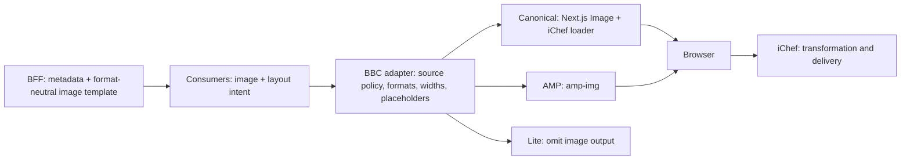
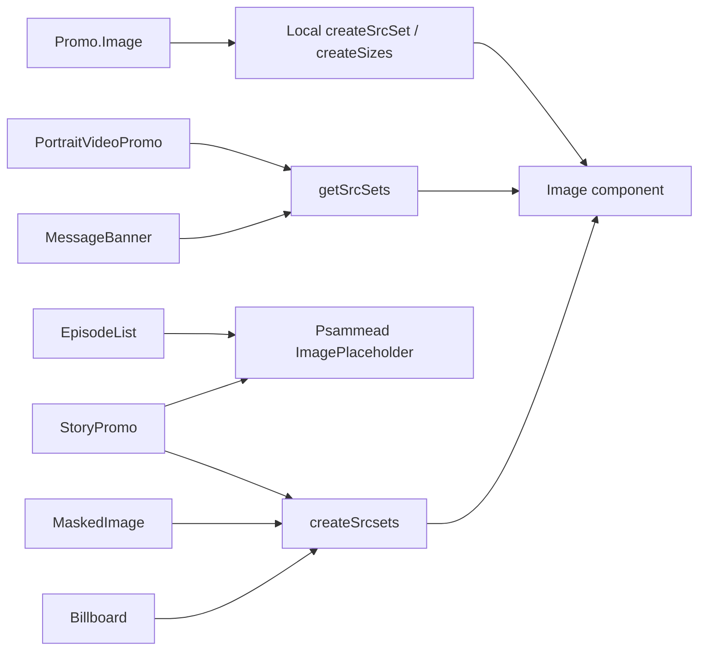
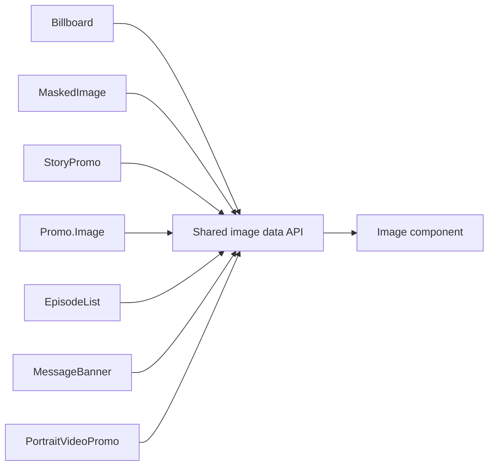
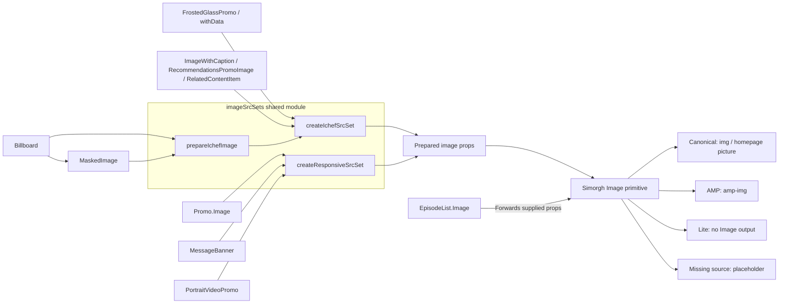
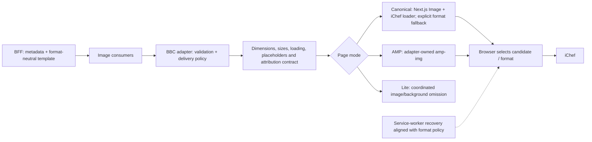

# Presentation: Simorgh image platform

**Image consolidation, Next.js suitability and next steps**

Duration: 3–5 minutes. Architecture detail is in the appendix.

## 1. Why: one reliable image boundary

- Image URL, responsive and format logic was spread across several paths.
- The task is to reduce duplication without losing required image behaviour.
- Two connected steps: **consolidate the existing platform**, then **evaluate Next.js Image**.

**Outcome sought:** easier maintenance, consistent behaviour and safer future format changes.

Sources: [original image-refactor brief](https://www.dropbox.com/scl/fi/e9224ij673u2u87r0a6ht/Image-Component-Refactor-Simorgh.paper?rlkey=r38irjxxi0pbi8km7h5zhed9p&dl=0),
[WS-63 / first PoC, PR #14352](https://github.com/bbc/simorgh/pull/14352),
[WS-3220](https://bbc.atlassian.net/browse/WS-3220).

---

## 2. Consolidation: initial, planned and actual

| Initial | Planned | Actual on the inspected branch |
| --- | --- | --- |
| Several image-preparation paths | Shared image-data API | Shared `imageSrcSets` helper module |
| Local and overlapping source-set logic | Reuse responsive generation | Shared generators with layout-specific configuration |
| Existing Image primitive plus legacy paths | Common rendering contract | Inspected consumers use Simorgh Image; EpisodeList forwards supplied props |
| Format preparation spread across callers | Consistent delivery policy | Some format and layout choices still remain in consumers |


**Value delivered:** reusable preparation helpers and a common renderer provide a stronger baseline for the Next.js investigation.

**Accuracy note:** PR #14352 was the initial audit/MessageBanner step, not the entire subsequent consolidation. Its audit confirms StoryPromo and Promo.Image already used the modern Image primitive.

Files: [shared image utilities](../src/app/utilities/imageSrcSets/index.ts),
[current Image](../src/app/components/Image/index.tsx).

---

## 3. What Next.js Image adds

Next.js Image is a React image component with responsive candidates, dimension handling and loading controls.

```tsx
import Image from 'next/image';
import { ichefLoader, POC_IMAGE_TEMPLATE } from '#nextjs/utilities/imagePoc';

<Image
  src={POC_IMAGE_TEMPLATE}
  loader={ichefLoader}
  width={624}
  height={351}
  sizes="(max-width: 600px) 100vw, 600px"
  alt="Example editorial image"
  loading="lazy"
/>;
```

- The custom loader resolves iChef `{width}` URLs.
- **iChef transforms and delivers the image bytes.**
- **The browser selects the image candidate.**
- This example is not the complete BBC adapter.

Files: [PoC loader](../ws-nextjs-app/utilities/imagePoc.ts),
[PoC adapter](../ws-nextjs-app/pages/ws/ImagePocAdapter.tsx).

---

## 4. Ideal Next.js architecture



**Proposed boundary:** BFF describes which image; frontend policy determines delivery and rendering.

Consumers retain layout knowledge. Frosted panels, media overlays and captions remain presentation concerns, coordinated with source and Lite policy. Service-worker recovery must align with the same format policy.

**Not implemented production architecture:** this is a direction to agree, not a completed migration.

Files: [adapter](../ws-nextjs-app/pages/ws/ImagePocAdapter.tsx),
[ownership and adoption findings](../ws-nextjs-app/Image-Suitability-Spike.md).

---

## 5. Show the image comparison

Open the isolated comparison: [localhost:7081/mundo/image-poc](http://localhost:7081/mundo/image-poc).

| Show | Expected outcome |
| --- | --- |
| Normal responsive image | Both render correctly; inspect selected URL, dimensions and source sets |
| Missing image / placeholder | BBC placeholder remains; no invalid image request |
| Portrait / caption | Intended crop, layout and attribution preserved |
| AMP / Lite | AMP image path; Lite omission rather than canonical image markup |

**Compare equivalent inputs:** same source, displayed size, dimensions, loading settings and agreed candidate widths.

The page demonstrates rendering behaviour. Shared caching and potentially different candidate ladders mean it is **not a fair performance benchmark by itself**.

Files: [comparison UI](../ws-nextjs-app/pages/ws/ImagePocComparison.tsx),
[candidate configuration](../ws-nextjs-app/utilities/imagePoc.ts),
[existing renderer](../src/app/components/Image/index.tsx).

---

## 6. Pros, cons and result

| Benefits / expected value | Costs / remaining risks |
| --- | --- |
| Shared BBC contract shields consumers from renderer changes | Not a drop-in replacement |
| Framework-supported canonical rendering | AMP and Lite still need explicit paths |
| Opportunity to reduce bespoke rendering maintenance | BBC placeholders, fallback and preload coordination remain our responsibility |
| Clearer place for delivery policy | Consumer inventory, browser checks and rollout work required |

**Result:** isolated PoC implemented; Next.js is suitable through a BBC-owned adapter. No production migration is included.

**Not proven:** faster rendering, lower memory use or reduced delivery cost.

Measure independently: LCP (main content appearing), CLS (visual stability), bytes, request count/preload reuse, client/server cost and memory.

Source: [investigation](../ws-nextjs-app/Image-Suitability-Spike.md).

---

## 7. Format comparison: WebP, AVIF and JPEG 2000

**JPEG 2000 = JP2, not JPEG XL. This is a technical comparison, not a measured PoC result.**

| Format | Opportunity | Limitation / decision |
| --- | --- | --- |
| JPEG | Broadly compatible fallback | Often more bytes than modern formats at comparable visual quality |
| WebP | Existing modern-format path | Preserve the explicit fallback strategy where required |
| AVIF | Potential byte savings at comparable quality | Verify iChef support, target browsers, quality and processing cost before adoption |
| JPEG 2000 / JP2 | Alternative codec with useful compression capabilities | Limited cross-browser suitability; not a general replacement for web delivery |

**No AVIF/JP2 quality, byte or timing measurements are claimed.**

For a fair follow-up: encode the same sources at the same dimensions, compare at similar perceived quality, and record bytes, decode cost, transparency/colour behaviour and browser support. Verify delivered `Content-Type`, not just the URL suffix.

`<picture>` supports format selection. It does **not** automatically retry JPEG when a selected WebP/AVIF request fails.

**Recommendation:** retain the current fallback contract; investigate AVIF behind one format policy. Do not select JP2 as the universal browser format.

References: [MDN image-format guide](https://developer.mozilla.org/en-US/docs/Web/Media/Guides/Formats/Image_types),
[current format helpers](../src/app/utilities/imageSrcSets/index.ts).

---

## 8. Decision and next steps

**Recommend the adapter-based direction; do not start production migration yet.**

1. Agree the shared contract and Simorgh/BFF ownership with [WS-66](https://bbc.atlassian.net/browse/WS-66).
2. Finish compatibility checks: consumers, AMP, Lite, fallback, preload and service worker.
3. Benchmark independently in production mode, including mobile and cold/warm caches.
4. Document guidelines and create the refactoring/format follow-ups.
5. Migrate incrementally only after approval, with a feature flag and rollback.

**Bottom line:** consolidation gives us a stable foundation; Next.js can supply canonical rendering without taking over BBC image policy or iChef delivery.

Source: [follow-up ticket proposals](../ws-nextjs-app/Nextjs-image-adoption-jira-tickets.md).

---

# Appendix: architecture diagrams

## A. Initial architecture: first PoC framing



Reproduces the supplied initial diagram as historical framing, not a freshly verified historical call graph. PR #14352 clarifies that StoryPromo and Promo.Image already used the modern Image primitive; placeholder dependencies should not be read as proof of a separate complete renderer.

## B. Planned architecture: first PoC target



Conceptual data flow: centralise reusable preparation and preserve one rendering contract.

## C. Actual architecture: inspected local implementation



- This is data flow, not literal React component nesting through helpers.
- Consumer-specific widths, `sizes`, format preparation and loading choices remain.
- Image omission does not automatically suppress decorative CSS backgrounds.
- StoryPromo's historical label is not mapped to an exact current component here.
- Local code is not proof of the deployed production version.

## D. Ideal Next.js architecture: proposed



No automatic Next.js optimisation proxy, cost saving or performance improvement is implied.

## Main implementation references

| File | Role |
| --- | --- |
| [Image/index.tsx](../src/app/components/Image/index.tsx) | Current rendering baseline |
| [imageSrcSets/index.ts](../src/app/utilities/imageSrcSets/index.ts) | Shared preparation helpers |
| [ichefURL/index.js](../src/app/lib/utilities/ichefURL/index.js) | Existing iChef URL builder |
| [ImagePocAdapter.tsx](../ws-nextjs-app/pages/ws/ImagePocAdapter.tsx) | Isolated BBC/Next.js adapter |
| [imagePoc.ts](../ws-nextjs-app/utilities/imagePoc.ts) | PoC loader, validation and candidates |
| [ImagePocComparison.tsx](../ws-nextjs-app/pages/ws/ImagePocComparison.tsx) | Side-by-side demo |

## Suggested opening

> We started by consolidating how Simorgh prepares images. The Next.js spike builds on that foundation: it shows a viable canonical renderer, but BBC policy and compatibility still need a clear shared boundary.

## Suggested closing

> The recommendation is to adopt the capability through a BBC adapter, not migrate blindly. Agree the ownership, prove compatibility and performance, then roll out safely.
