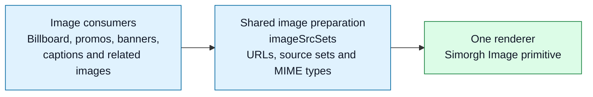
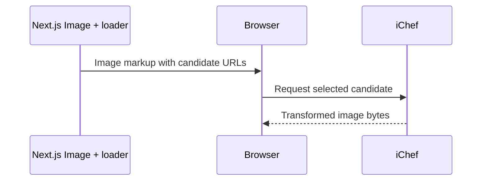
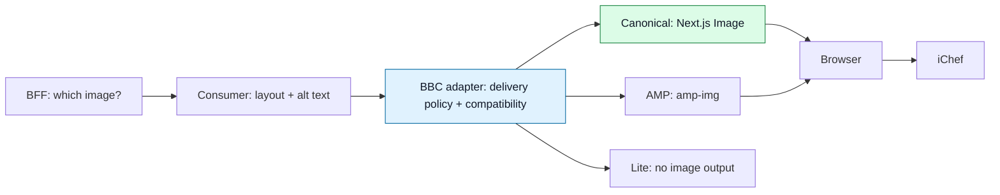
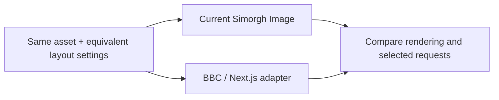
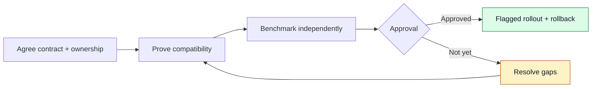

# Simorgh images: simplify first, adopt safely

**Research:** [Next.js Image for Simorgh — findings and recommendation](https://www.dropbox.com/scl/fi/tl110z47w2iceakef8duq/Next.js-Image-for-Simorgh.paper?rlkey=sdpic0zfp4mpiorfbo4gyeqje&dl=0)

**Shared image logic today. Next.js rendering next.**

## 1. Why this work?

Image preparation was spread across components. We want **one reliable contract**, without losing BBC behaviour.

### First task: how we addressed image consolidation

- **Audited the existing paths.** StoryPromo and Promo.Image already used the modern Image primitive; duplicated preparation logic was the main consolidation opportunity.
- **Shared the preparation.** Moved reusable source-set, iChef URL and MIME-type logic into shared helpers, while keeping layout-specific settings with consumers.
- **Preserved the rendering contract.** Retained canonical, AMP, Lite, placeholders and loading behaviour through the shared Image primitive; added regression coverage for affected paths.

**Result:** less duplicated preparation and a stronger baseline for the Next.js spike, not a wholesale replacement of every legacy wrapper. Remaining legacy removal and BFF ownership decisions are separate follow-ups.


**Preserving existing behaviour is a requirement throughout, not a separate delivery step.**

Sources: [original brief](https://www.dropbox.com/scl/fi/e9224ij673u2u87r0a6ht/Image-Component-Refactor-Simorgh.paper?rlkey=r38irjxxi0pbi8km7h5zhed9p&dl=0),
[first PoC / PR #14352](https://github.com/bbc/simorgh/pull/14352),
[Next.js spike / WS-3220](https://bbc.atlassian.net/browse/WS-3220).

---

## 2. Architecture: before, planned, now

### Before: several preparation paths

```mermaid
flowchart LR
    P["Promo.Image"] --> L["Local source sets / sizes"]
    V["PortraitVideoPromo + MessageBanner"] --> G["getSrcSets"]
    B["Billboard + MaskedImage + StoryPromo"] --> S["createSrcsets"]
    L --> I["Image primitive"]
    G --> I
    S --> I
    E["EpisodeList + StoryPromo"] --> PH["Legacy placeholder dependency"]
    style L fill:#fef3c7,stroke:#b45309,color:#111827
    style G fill:#fef3c7,stroke:#b45309,color:#111827
    style S fill:#fef3c7,stroke:#b45309,color:#111827
```



Historical summary from the first PoC. StoryPromo and Promo.Image already used the modern Image primitive; a placeholder dependency was not a separate complete renderer.

### Planned: shared preparation


### Now: shared helpers and one renderer



**Delivered:** shared preparation helpers and common rendering.

**Still local:** some width, `sizes`, format and layout choices.

The diagram groups the shared helpers as one preparation layer, not one mandatory function. EpisodeList forwards supplied props directly to the same renderer. These are inspected branch flows, not deployed-version claims; the historical StoryPromo label is not mapped here.

Files: [shared helpers](../src/app/utilities/imageSrcSets/index.ts), [current Image](../src/app/components/Image/index.tsx).

---

## 3. What is Next.js Image?

The framework's React image component: **responsive candidates, dimensions and loading controls**.

```tsx
import Image from 'next/image';
import { ichefLoader, POC_IMAGE_TEMPLATE } from './utilities/imagePoc';

<Image
  src={POC_IMAGE_TEMPLATE}
  loader={ichefLoader}
  alt="Example editorial image"
  width={624}
  height={351}
  sizes="(max-width: 600px) 100vw, 600px"
  loading="lazy"
/>;
```

Illustrative usage from the Next.js app root, not the complete BBC adapter.



**Next.js generates markup. The browser selects. iChef transforms and delivers.**

Files: [loader](./utilities/imagePoc.ts), [adapter](./pages/ws/ImagePocAdapter.tsx).

---

## 4. Proposed next step: a BBC-owned adapter

An adapter is a small BBC layer that keeps our image contract stable while choosing the renderer.



- **Central policy:** source validation, format selection and candidate widths.
- **BBC contract:** placeholders, attribution, aspect ratios and loading behaviour.
- **Presentation stays with components:** frosted panels, headlines and media overlays.
- **Coordinate:** decorative backgrounds and service-worker recovery follow the same Lite/format policy.

**Proposed direction, not a production migration.**

Sources: [PoC adapter](./pages/ws/ImagePocAdapter.tsx), [ownership findings](./Image-Suitability-Spike.md), [WS-66](https://bbc.atlassian.net/browse/WS-66).

---

## 5. Show the comparison

**Consolidation showcase:** [all Image options and consumer examples on one Storybook page](http://localhost:9001/iframe.html?id=components-image-temporary-showcase--all-options&viewMode=story).

**Demo:** [localhost:7081/mundo/image-poc](http://localhost:7081/mundo/image-poc)



| Show | Look for |
| --- | --- |
| Responsive image | Selected URL, dimensions and loading |
| Missing image | Placeholder; no invalid request |
| Portrait / caption | Correct crop and attribution |
| AMP / Lite | Correct output, including image omission |

**Before comparing:** align candidate widths, dimensions, `sizes` and loading settings.

**This is a rendering demo, not a performance benchmark.** Shared caching can distort results.

Files: [comparison UI](./pages/ws/ImagePocComparison.tsx), [candidate settings](./utilities/imagePoc.ts).

---

## 6. Value and trade-offs

| Gain | Responsibility we keep |
| --- | --- |
| Reusable image preparation | Consumer-specific layout intent |
| Framework-supported canonical rendering | AMP and Lite paths |
| Potentially less bespoke maintenance | BBC placeholders, fallback and preload coordination |
| Stable BBC API for future changes | Compatibility tests and safe rollout |

**PoC result:** Next.js is suitable through an adapter, not as a drop-in replacement.

**Not proven:** faster pages, lower memory use or cheaper image delivery. iChef still delivers the bytes.

Source: [investigation](./Image-Suitability-Spike.md).

---

## 7. Formats: what should we compare?

| Format | Role | Decision |
| --- | --- | --- |
| JPEG | Broadly compatible fallback | Preserve where required |
| WebP | Existing modern-format path | Preserve current compatibility |
| AVIF | Potential byte savings | Investigate iChef support, visual quality and browser/decode cost |
| JPEG 2000 / JP2 | Alternative codec; limited browser coverage | Not a universal web replacement |


**No AVIF/JP2 measurements are claimed.** JPEG 2000 is not JPEG XL.

Format-support fallback is not network-error recovery: `<picture>` does not automatically retry JPEG after a selected WebP/AVIF request fails.

References: [format guide](https://developer.mozilla.org/en-US/docs/Web/Media/Guides/Formats/Image_types), [current format helpers](../src/app/utilities/imageSrcSets/index.ts).

---

## 8. Decision: proceed, with gates



**Compatibility:** canonical, AMP, Lite, fallback, preload and service worker.

**Performance:** LCP (main content appearing), CLS (page stability), bytes, requests, JavaScript/server cost and memory.

> Consolidation gives us the foundation. Next.js can supply canonical rendering; BBC policy and iChef delivery remain ours.

**Decision requested:** agree the adapter direction and validation gates. No production migration before approval.

Next steps: [follow-up ticket proposals](./Nextjs-image-adoption-jira-tickets.md).

---

## Conclusion: proceed with a BBC adapter around Next.js Image

**Choose adapter-based adoption over direct replacement or separate implementations in every consumer, because:**

1. **It builds on the consolidation.** Keep shared preparation and a stable BBC API instead of spreading image logic again.
2. **It preserves required behaviour.** Next.js handles canonical rendering; explicit BBC paths retain AMP, Lite, placeholders, fallback and attribution.
3. **It offers a maintenance benefit.** Use framework-supported canonical rendering rather than maintaining all of that behaviour ourselves.
4. **It creates a clearer policy boundary.** Future format changes, such as AVIF, can follow one delivery policy instead of independent consumer changes.
5. **It keeps adoption reversible.** Compatibility gates, benchmarks and a flagged rollout let us validate the change before retiring the existing primitive.

**Why not replace Image directly?** Next.js alone does not cover the full BBC contract.

**Why not claim a performance win now?** The PoC proves rendering feasibility, not faster pages or lower cost; iChef still transforms and delivers images.

> **Approve the direction now. Approve production migration only after compatibility and performance evidence.**

### Why faster pages or lower cost are not guaranteed

- **Same image service.** Our custom loader builds iChef URLs; it does not add Next.js image compression or replace iChef delivery.
- **Same bytes can mean the same download time.** If the selected width, format and quality stay the same, switching the React component alone does not make the image smaller.
- **The current component already has performance features.** Responsive sources, lazy loading, reserved image space and preload are not new benefits by themselves.
- **Page speed depends on more than images.** Request timing, caching, network conditions, JavaScript and server work also matter. The new implementation could improve or regress these.
- **Delivery savings require a measurable change.** Lower transferred bytes, fewer requests or less transformation work might reduce cost, depending on the service's cost model. Changing the renderer alone proves none of these.

**What we can claim now:** rendering feasibility and an opportunity to simplify maintenance.

**What needs evidence:** faster pages, lower infrastructure cost and the size of any maintenance saving. Compare old and new independently in production mode, using equivalent images and cold/warm caches.
